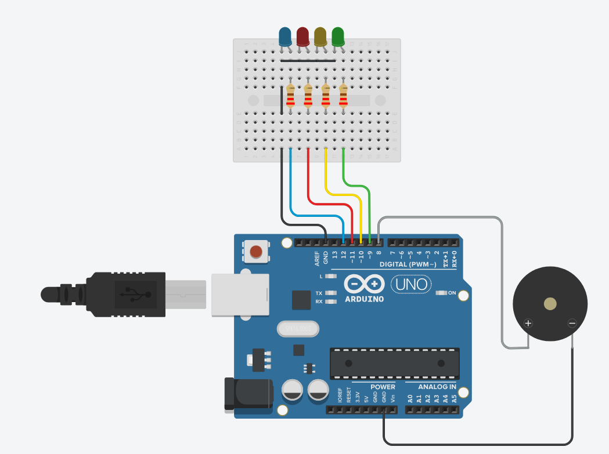

# OpenCode Hardware Notifier

Physical status feedback for [OpenCode](https://opencode.ai). An Arduino drives a buzzer and four LEDs whenever the agent starts working, finishes, fails, or needs your attention.



---

## Status reference

| State   | Trigger                          | Buzzer                | LED    |
|---------|----------------------------------|-----------------------|--------|
| READY   | Plugin connected                 | 2 short beeps         | -      |
| WORKING | Prompt sent / execution started  | Long 800 Hz beep      | Green  |
| IDLE    | Succeeded or cancelled           | Short 1200 Hz beep    | Yellow |
| ERROR   | Execution failed                 | 3 fast 600 Hz beeps   | Red    |
| PROMPT  | Permission / question (reserved) | Double ascending beep | Blue   |

A state is only sent when it changes, so the buzzer never repeats itself.

## Features

- Distinct sound and colour for each state
- Immediate feedback when a prompt is sent, before the model starts thinking
- Correct handling of cancellation, including cancelling before processing begins
- Repeat suppression in both the plugin and the Arduino
- Boot delay for boards that reset when the serial port opens
- Debug log at `/tmp/opencode-buzzer-debug.log`

## Hardware

- Arduino Uno, Nano, Leonardo, or similar
- 1x buzzer (active or passive - `tone()` drives both)
- 4x LEDs: green, yellow, red, blue
- 4x 220 ohm resistors
- Breadboard and jumper wires

### Wiring

| Arduino pin | Component                            |
|-------------|--------------------------------------|
| 8           | Buzzer +                             |
| 9           | Green LED anode (220 ohm resistor)   |
| 10          | Yellow LED anode (220 ohm resistor)  |
| 11          | Red LED anode (220 ohm resistor)     |
| 12          | Blue LED anode (220 ohm resistor)    |
| GND         | Buzzer - and all LED cathodes        |

> The Tinkercad diagram above is a visual reference. The pin table matches the default pins in the sketch - adjust either if you wire it differently.

If you use an RGB LED instead of separate LEDs, replace `setLeds()` with three `analogWrite()` calls.

## Setup

### 1. Flash the Arduino

Open `arduino/buzzer_notifier.ino` in the Arduino IDE, select your board and port, and upload.

### 2. Install the plugin

```bash
mkdir -p ~/.config/opencode/plugins
cp plugin/buzzer.js ~/.config/opencode/plugins/buzzer.js
```

OpenCode v2 auto-loads plugins from that directory. If yours does not, register it in `~/.config/opencode/cli.json`:

```jsonc
{
  "plugins": ["./plugins/buzzer.js"]
}
```

The plugin uses only Node.js built-in modules, so no dependencies are needed. Keep a `package.json` next to it if OpenCode tries to run an install.

### 3. Check the serial port

The default is `/dev/ttyUSB0` at 9600 baud. If your board appears elsewhere, update `PORT` and `BAUD` at the top of `plugin/buzzer.js`:

```bash
ls /dev/ttyUSB* /dev/ttyACM*
```

On Linux, grant access to the port (usually the `dialout` group), then log out and back in:

```bash
sudo usermod -aG dialout "$USER"
```

### 4. Restart OpenCode

```bash
opencode
```

You should hear the `READY` double beep when the plugin connects.

## Testing

Send a status manually:

```bash
echo "WORKING" > /dev/ttyUSB0
```

Follow the plugin events live:

```bash
tail -f /tmp/opencode-buzzer-debug.log
```

Then start a task in OpenCode and watch the LED and buzzer change.

## Troubleshooting

| Symptom                         | Likely cause                                                     |
|---------------------------------|------------------------------------------------------------------|
| No sound at all                 | Wrong port, missing `dialout` permission, or board not flashed   |
| Sound only once at startup      | Plugin connected but no event matched - check the debug log      |
| Stuck on green after cancelling | Cancellation event name not covered - check the debug log        |
| `NpmInstallFailedError`         | Add a `package.json` with no dependencies next to the plugin     |
| Continuous buzzing              | An event match is too broad and firing on background events      |

## License

[MIT](LICENSE)
